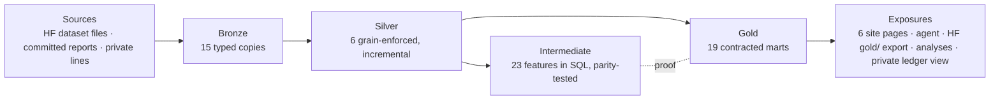
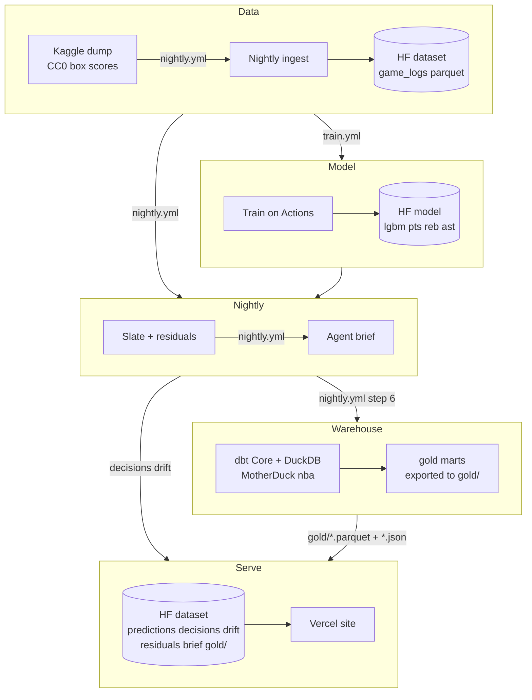

# NBA Stat Predictor

An analytics-engineering warehouse built around a frozen NBA player-stat model: every number the site shows is recomputed in dbt, reconciled to a committed artifact, and traced through lineage that ends in the pages that read it. A nightly batch job predicts points, rebounds and assists from each player's earlier games; the warehouse proves what its files say.

[](https://github.com/cbratkovics/nba-ai-ml/actions/workflows/ci.yml)
[](https://github.com/cbratkovics/nba-ai-ml/actions/workflows/nightly.yml)
[](LICENSE)
[](pyproject.toml)

[dbt docs](https://cbratkovics.github.io/nba-ai-ml/) · [Live site](https://nba-ai-ml.vercel.app) · [Evaluation](docs/MODEL_CARD.md)



**What it found.** The model beats the last-10-game mean by 2–3% MAE on its training population and loses on all rows; both are published.

**How trust is established**

- **Contracts** on every gold model and the silver table all of them read. [→](#contracts)
- **Reconciliation**: marts recompute the replay and match the committed reports to float noise. [→](#reconciliation-to-committed-artifacts)
- **Feature parity**: 23 features in SQL equal the Python module over 130,414 rows; tolerance set from the measurement. [→](#feature-parity)
- **Tests**: 93 data tests and a unit test of the settlement rule; an artifact mismatch blocks the publish. [→](#tests)
- **Run evidence**: "ran" means a recorded run id; counts are rendered from the manifest. [→](#run-evidence)
- **Pre-registered out-of-sample evaluation** against market lines, behind a credit guard, reported with n and intervals. [→](#pre-registered-out-of-sample-evaluation)

**Start here**: [`int_player_game_features.sql`](dbt/models/intermediate/int_player_game_features.sql) with [`assert_int_features_match_feature_module.sql`](dbt/tests/intermediate/assert_int_features_match_feature_module.sql); [`assert_policy_sweep_reconciles_to_policy_report.sql`](dbt/tests/gold/assert_policy_sweep_reconciles_to_policy_report.sql); [`exposures.yml`](dbt/models/exposures.yml).

**Status.** Running: nightly pipeline, weekly MotherDuck refresh, site, agent evaluation, line capture (dry run until 2026-10-20). Planned: a date dimension, written metric definitions, more unit tests, source freshness, a fantasy-points projection layer. Free tiers only.

## Evidence

Every claim above, with its artifact keys and decision records ([docs/DECISIONS.md](docs/DECISIONS.md)). The citable facts per phase are listed in [docs/STORIES.md](docs/STORIES.md).

### Contracts

Enforced on every gold model and on `slv_game_logs`, the one silver table every mart and the feature parity proof read; the other silver tables are incremental and keep their contracts as tests (ADR-0025). `dbt build`: <!-- dbt-counts -->41 models (15 bronze, 6 silver, 1 intermediate, 19 gold; 3 incremental, 20 with enforced contracts), 4 seeds, 1 snapshot, 93 data tests (15 singular, 78 generic), 1 unit tests, 14 sources, 11 exposures, 886 documented columns<!-- /dbt-counts -->. Built weekly on MotherDuck and on every pull request against a local DuckDB file (slim CI deferring to the cached `main` build); docs with every column described are published to GitHub Pages.

### Reconciliation to committed artifacts

The gold marts recompute the replay's numbers from the residual rows and match [reports/replay_2025-26.json](reports/replay_2025-26.json) and [reports/replay_all_rows_2025-26.json](reports/replay_all_rows_2025-26.json) to within 1e-14 with exact row counts, and [reports/metrics.json](reports/metrics.json) to within 0.0022 (the replay never slated 169 of the 22,244 holdout rows; ADR-0011). `fct_decision_policy` applies the committed thresholds to every prediction, and two singular tests recompute every number in [reports/policy_2025-26.json](reports/policy_2025-26.json), including every point of the coverage curve (counts exact, rates within 1e-6; ADR-0015). A mart never replaces an artifact; a reconciliation failure is severity `error` and nothing publishes until it passes, while an operational threshold warns and opens one idempotent issue (ADR-0026).

### Feature parity

The model's 23 `asof_v1` features are rendered in SQL (`int_player_game_features`, a non-exported intermediate layer) and compared row for row with the Python feature module's own output over all 130,414 game logs, inside every `dbt build`. Measured ([reports/feature_parity_asof_v1.json](reports/feature_parity_asof_v1.json), `make parity`): the largest absolute difference is 0.0 on 19 features and 2.1e-14 on the four minutes means (summation order on fractional minutes); zero null mismatches. The test's tolerance, 1e-12, is set from that measurement, about 50× the largest observed difference and a thousand times below any formula difference; at a tolerance of 0 the test fails on 42,828 rows, all on those four columns, and a pytest perturbs one value by 0.01 and asserts the test fails on exactly that row. The Python module stays the one that serves (ADR-0032).

### Tests

93 data tests (15 singular, 78 generic) and one dbt unit test. The unit test fixes the paper-ledger settlement rule on constructed rows: `pending` while the game's box score is absent, `void` only when the box score exists and the player has no row in it, and a row with any minutes played, even under one, stands (ADR-0030). Two singular tests enforce the ledger's timestamp rule: no entry whose prediction was generated after its line, none whose line was read after tip-off (ADR-0031). The Python suite runs the dbt proofs on fixture rows as well: two opening nights end to end, a restatement inside the lookback, the parity test, and the exposures kept in step with the pages.

### Run evidence

"Ran" means a run id in [reports/runs.json](reports/runs.json); `tests/test_runs.py` fails when a cited id is missing, and the dbt counts above are rendered from the manifest by `scripts/render_dbt_counts.py`, never typed (ADR-0022, which also records how the `gold/` export stayed three weeks stale behind a workflow-expression bug until the run steps were read). Status words have one meaning each: the weekly full refresh **has run on MotherDuck** (first `35048092357`, latest `38094691169`, which also pushed the first `gold/*.json` at dataset revision `aa30dde9`); the nightly's incremental build **is implemented and rehearsed** on a synthetic game night that cannot write to Hugging Face, locally and on a scratch MotherDuck database (`38008927282`, `38011203767`; ADR-0028), not yet run on a live slate.

### Pre-registered out-of-sample evaluation

From opening night the frozen model is evaluated against market lines, on paper, under a rule written and hashed before the first game and never tuned on the season ([`nba/ledger/rule.py`](nba/ledger/rule.py); ADR-0030, approved with amendments before the first live date). The rule: a player is eligible with a prior game this season, a last-10 minutes mean of at least 15 and inputs at most 10 days old (chosen on the 2025-26 replay, [reports/ledger_rule_evidence_2025-26.json](reports/ledger_rule_evidence_2025-26.json): proxy precision 0.957, recall 0.863); an entry is recorded when the prediction sits at least 1.75 points from the line, over above it and under below it; flat one unit; settled from the box scores whenever they arrive. Capture is one snapshot a day from a documented odds API behind a credit guard that fails closed at 425 of the free plan's 500 monthly credits, with the decision to capture written before any line is fetched so no night can be dropped afterwards, names matched deterministically with unmatched counts published, and a dbt test rejecting any row that breaks the timestamp rule (ADR-0031). Raw lines stay in a private repository; the public marts (`mart_ledger`, `mart_ledger_by_side`, `mart_ledger_by_edge`, `mart_ledger_coverage`) carry aggregates with sample sizes and 95% half-widths, labelled out of sample and never pooled with the in-sample replay. Under 100 settled entries the verdict is "too early"; above that, the interval and the break-even rate implied by the prices are shown and a verdict is given only when the interval excludes break-even. Separating a 55% hit rate from the 52.4% break-even of −110 takes about 1,400 settled entries, more than one season of points lines will produce, and the README says so now rather than later. No result exists yet.

## Architecture



There is no API server and no database on the serving path: every page fetches published files from the Hugging Face dataset repo, and the pages `/`, `/replay`, `/decisions` and `/ledger` read the gold marts as small JSON exports first, with the product files they read before as fallback, naming the source they rendered (ADR-0033). The warehouse sits upstream of that path. The agent's tools read the exported parquet marts with reconciled product-file fallbacks.

| Stage | Evidence-backed status | Artifact |
|---|---|---|
| Ingest from the Kaggle dump | Ran in GitHub Actions (`34668092730`); the recorded off-season run reconciled without a data change | `game_logs/<season>.parquet`, `daily_reports/<date>.json` |
| Train and evaluate | Ran in Actions and reached the HF model repo at revision `fb427de` | `lgbm_{pts,reb,ast}.txt`, `reports/metrics.json` |
| Slate, residuals and season replay | Replay ran in Actions (`34668262142`) and its products reached HF; replay covers 164 game dates | `reports/replay_2025-26.json`, `replay/2025-26/` |
| Agent evaluation | Repeated live evaluations ran in Actions (`35073930571` through `35499665725`); all 25 completed runs are recorded | `reports/agent_pass_rates.json` |
| Site | Fetch-only site deployed on Vercel; the served revision is an owner check after each merge | `/`, `/predictions`, `/replay`, `/decisions`, `/ledger`, `/brief` |
| Decision policy and drift | Drift: ran in every nightly since 2026-09-16 and pushed `drift/<date>.json` each time. Decisions: implemented; written only on nights with a slate, so none before 2026-27 | `reports/policy_2025-26.json`, `reports/drift_calibration_2025-26.json`, `drift/` |
| Warehouse | Weekly full refresh ran on MotherDuck (`35048092357` … `38094691169`, `PASS=140` at the latest); `gold/` pushed at `aa30dde9`; the nightly incremental path is rehearsed (ADR-0028), not yet run live | bronze/silver/intermediate/gold marts, `reports/runs.json` |
| Line capture and ledger | Capture ran in dry run from Actions (`38090769175`, `38090879502`: out of season, zero credits, private repo created); the ledger marts build empty until the first captured night | `captures/`, `lines/` (private), `mart_ledger*` |

## Results

Source: [reports/metrics.json](reports/metrics.json) for model `commit 50a3b2e / HF fb427de` (the one identity used everywhere: the git commit of the training code and the Hugging Face revision holding the files; both are pinned in `nba/config.py`). Train on 2021-22 through 2024-25 (88,257 rows), holdout is all of 2025-26 (22,630 rows, 2025-10-21 to 2026-04-12). **Population: rows with at least 10 minutes played, scored on the 22,244 rows where both baselines exist (the training population).** Baselines are the player's last-10-game mean and season-to-date mean.

| Target | Model MAE | Last-10 MAE | Season MAE | Model RMSE | Model R² | Keys in `reports/metrics.json` |
|---|---:|---:|---:|---:|---:|---|
| pts | 4.764 | 4.908 | 4.946 | 6.160 | 0.457 | `metrics.pts.{model,baseline_last10,baseline_season}.mae`, `metrics.pts.model.{rmse,r2}` |
| reb | 1.942 | 2.009 | 2.008 | 2.527 | 0.402 | `metrics.reb.*` |
| ast | 1.431 | 1.460 | 1.456 | 1.909 | 0.461 | `metrics.ast.*` |

The evaluation id is the model identity, `commit 50a3b2e / HF fb427de` (`git_sha` and the
Hugging Face revision in `metrics.json`; `n` = 22,244 for every predictor). The model card,
[docs/MODEL_CARD.md](docs/MODEL_CARD.md), is rendered from this file and the config and is
the canonical statement of what the model is and how it was evaluated; this README quotes
it and never adds a number the artifacts do not carry.

Replay equivalence ([reports/replay_2025-26.json](reports/replay_2025-26.json), keys `mae_restricted.<target>`, `diff_vs_metrics_json.<target>`, `n_restricted` = 22,075): same population, MAE differs from metrics.json by +0.0021 pts, +0.0008 reb, +0.0010 ast, within the 0.05 tolerance. The 169 holdout rows the slate path never produces are why the two are not identical (ADR-0011).

**All rows (replay population).** On every replayed player-game with a box score and a last-10 baseline for every target (26,031 rows over the 164 dates; this includes games under 10 minutes) the last-10 mean has the lower MAE on every target: pts 4.679 vs 4.864, reb 1.939 vs 2.023, ast 1.374 vs 1.403 (row-weighted from [reports/replay_all_rows_2025-26.json](reports/replay_all_rows_2025-26.json), a committed copy of `replay/2025-26/daily_mae.json` at dataset-repo revision `6cbc915b`, keys `days[].model` and `days[].baseline_last10` weighted by `days[].n`; the site reads the warehouse's `mart_holdout_metrics`, which a dbt test holds to this report, with the derived `frontend/lib/all_rows_baseline.json` as fallback; the model's all-rows MAE is also `mae_unrestricted` in the committed replay report). The model's edge exists only on the training population; the decision policy below is evaluated on both.

**Decision policy** ([reports/policy_2025-26.json](reports/policy_2025-26.json), keys `populations.<population>.targets.<target>.{threshold,coverage,n_resolved,hit_rate,baselines.season_mean_sign.hit_rate,coverage_curve}`; ADR-0001, ADR-0006, ADR-0015). A line-free call per player and stat: over when the prediction exceeds the player's last-10 mean by more than a threshold, under when it falls short by more, else no call; a call resolves against the same mean. Thresholds are the largest grid value that still calls 25% of the rows, chosen on the replay rows themselves (in-sample), and the artifact carries the whole coverage curve. Hit rates on resolved calls, against the season-mean sign scored on exactly the same rows (a coin flip is 0.5; where the season-mean sign has no side it is scored as a coin flip and the abstentions are counted in the artifact):

| Population | Points | Rebounds | Assists |
|---|---|---|---|
| Training population (22,075 rows) | 0.667 vs 0.592 at threshold 1.75 (6,680 calls) | 0.660 vs 0.590 at 0.70 (6,516) | 0.633 vs 0.595 at 0.50 (5,914) |
| All rows (26,031 rows) | 0.547 vs 0.566 at 2.25 (6,890) | 0.539 vs 0.566 at 0.90 (6,780) | 0.537 vs 0.564 at 0.50 (8,108) |

On all rows the model's calls hit less often than the season-mean sign on the same rows, so the policy is not recommended there; the site's `/decisions` page says so and the nightly decisions file carries both populations' calls.

**Drift monitoring** ([reports/drift_reference_asof_v1_fb427de.json](reports/drift_reference_asof_v1_fb427de.json), [reports/drift_calibration_2025-26.json](reports/drift_calibration_2025-26.json) keys `chosen.threshold`, `false_positives_total`, `positions.<position>.{psi,false_positives}`, `sensitivity`; ADR-0016 to ADR-0018). The 14-day check compares each feature with a season-day-aligned reference. It was calibrated retrospectively on all 164 replay dates; 157 had enough rows to score. The selected rule—HOLD when at least three features have PSI ≥ 0.15—had no alerts on those calibration dates, while 0.05 would have fired on 69. That is a calibration-set observation, not a prospective false-positive guarantee: an untouched season remains untested. The nightly path writes `drift/<date>.json` (and has, every run since 2026-09-16; `reports/runs.json`), opens a labelled issue on HOLD, and never blocks the slate. What each alert means and what to do is in [docs/RUNBOOK.md](docs/RUNBOOK.md).

Provenance: [reports/provenance_b20b5601.json](reports/provenance_b20b5601.json) records the SHA-256 of every parquet file at dataset revision `b20b5601`, of the model files and `metrics.json` at HF revision `fb427de`, of the committed reports (including the all-rows file above), and of the replay products the site reads.

Agent evals ([reports/agent_evals.json](reports/agent_evals.json) keys `grounding_pass`, `n_briefs`, `golden_pass`, `golden_total`, `golden_facts`; [reports/agent_pass_rates.json](reports/agent_pass_rates.json) key `overall`), model `openai/gpt-oss-120b`. The agent is a consumer of the warehouse: four of its seven read-only tools read the exported gold marts, and every number in a finding must match its cited tool output.

| Check | Result |
|---|---|
| Grounding: every number in a finding matches its cited tool output within 0.01 | 6 of 6 briefs (23 of 23 findings) |
| Golden set (version 2): a finding names the day's largest-points-residual player, a finding carries the decision policy's hit rate to date, a finding names the drift status | 5 of 5 dates, all three facts each |
| Pass rates over repeated runs (`agent-eval.yml`, 5 per date; row rendered from the report) | <!-- pass-rates -->grounding 25 of 25, golden 25 of 25 (5 dates × 5 runs, `openai/gpt-oss-120b`)<!-- /pass-rates -->; see [docs/agent.md](docs/agent.md#reliability) |

<details>
<summary>Running it locally</summary>

```bash
python3.11 -m venv .venv && source .venv/bin/activate
pip install -e ".[dev]"
pytest

python -m nba.storage.hf pull-dataset          # game logs from the HF dataset repo
python -m nba.models.train                     # writes reports/metrics.json
python -m nba.nightly --date 2026-04-12        # ingest, slate, residuals, brief for one date
python -m nba.agent.loop --date 2026-04-12     # brief only; needs GROQ_API_KEY

make dbt-load && make dbt-full && make dbt-docs   # warehouse on a local DuckDB file (dbt/, ADR-0003..0014)
make parity                                       # reports/feature_parity_asof_v1.json from the built warehouse
```

LightGBM needs OpenMP at runtime (`brew install libomp` on macOS). Secrets used by the workflows: `HF_TOKEN`, `KAGGLE_USERNAME`, `KAGGLE_KEY`, `GROQ_API_KEY`, `MOTHERDUCK_TOKEN`, `ODDS_API_KEY`. Repo ids, the model identity (`MODEL_COMMIT`, `MODEL_REVISION`), the dataset revision, and thresholds live in `nba/config.py`. The dataset and model cards are rendered from that config (`python -m nba.storage.dataset_card`, `python -m nba.models.publish --card-only`); their canonical copies are `docs/DATASET_CARD.md` and `docs/MODEL_CARD.md`.

</details>

## Limitations

- **The model's edge exists on one population.** On the training population (10+ minutes, both baselines defined; 22,244 holdout rows) the model beats the last-10 mean on every target. On all replayed rows (26,031, including games under 10 minutes) the last-10 mean has the lower MAE on every target, and the decision policy's calls hit less often than the season-mean sign on the same rows (0.547 vs 0.566 on points). Every page names its population; the policy is not recommended on all rows (ADR-0002, ADR-0015).
- **Thresholds, bands and the drift rule are in-sample on 2025-26.** The policy's thresholds and residual bands were chosen on the same replay rows used for its reported hit rates; those rates are policy-fit results, not out-of-sample validation. The drift rule was likewise selected on 164 replay dates (157 scoreable), where it produced no alerts. Neither result guarantees prospective reliability; 2026-27 is the first out-of-sample test (ADR-0006, ADR-0017, ADR-0018).
- **One upstream data source, lagging, with known gaps.** The Kaggle dump is the only automated source of box scores: stats.nba.com is unreachable from GitHub Actions runners (HTTP 403), so the pipeline lags the dump's own refresh and settles nothing while it is silent. Seven 2024-25 games have no box scores in it (1,223 of 1,230; the ids are in docs/reconciliation.md and `list_data_gaps`) and are not filled in from anywhere. The dump was last updated 2026-06-15 and has no 2026-27 schedule file (checked 2026-10-10); the schedule has a free fallback through the odds API's event list (ADR-0029), the box scores do not (docs/AE_AUDIT.md §12 lists the licensed alternatives and when to adopt one).
- **The ledger is empty until the season starts, and thin after it.** First possible entry 2026-10-20; the rule expects none on opening night. One book (DraftKings) and the points market only through the free API; rebounds, assists and a second book enter only by hand, in rows reported apart from the headline. One snapshot a day; games already under way are excluded and counted. Every number carries its n and interval; in-sample results are never pooled with it (ADR-0030, ADR-0031).
- **No availability input.** The model does not know who is injured, resting or starting; it does not predict minutes or whether a player plays, and a player with no game in their team's previous ten is not slated (169 holdout rows). A line set after news the model has not seen is a line it will look wrong about. Did-not-play entries are void and counted, by the rule.
- **The agent brief is not deterministic.** At temperature 0 the model's output can still vary, so a future brief can drop an ungrounded finding or miss a golden fact. Five Actions runs completed 25 of 25 briefs under golden set version 2, all passing both checks; that is evidence on five selected historical dates, not a guarantee for future dates.
- **Model scope.** One LightGBM regressor per target on 23 rolling and situational features, frozen at `fb427de`; a new target would be a separately versioned model with its own committed evaluation.
- **Deployment boundary.** "Ran" means a run id in `reports/runs.json`; "deployed" means a URL that answers. By that standard the model, dataset, replay products, site, repeated agent evaluation, nightly drift reports, weekly MotherDuck build and the `gold/` export (parquet and JSON, `aa30dde9`) have run. Two things have not: the nightly's own warehouse build on a live slate (rehearsed, ADR-0028) and a decisions file (none until the first slate). The served site revision is an owner check after each merge.
- **Off-season behaviour.** With no schedule file for the next season, or no games on the date, the nightly job logs one line and exits 0. The drift check reports `insufficient` (no rows in the window), no decisions file is written, and the site's `/predictions` and `/decisions` pages say so.

## How this was built

By the owner, with Claude Code doing the typing under direction and review, in phases that each ended at a checkpoint: a read-only audit first ([docs/AE_AUDIT.md](docs/AE_AUDIT.md)), then rulings from the owner on every open question, then one pull request per phase with small commits, CI green, and a written record. The constraints were fixed up front and never relaxed: $0 a month with no card on file, no retraining of the published model, nothing on the serving path but static files, every number traced to a committed artifact, status words that mean something ("ran" needs a run id), and no tool added to tick a box. Decisions are in [docs/DECISIONS.md](docs/DECISIONS.md) (33 records), operations in [docs/RUNBOOK.md](docs/RUNBOOK.md), and the list of what may be claimed about the work, with the artifact behind each claim, in [docs/STORIES.md](docs/STORIES.md).

## Owner TODO (in execution order)

1. ~~Confirm a successful `warehouse.yml` run and its target~~ — done: recorded in `reports/runs.json` (ADR-0022).
2. After the first in-season `nightly.yml` run, confirm `WAREHOUSE build`, a dbt `ERROR=0` line and `PUBLISH pushed gold marts` in its summary, then `python scripts/record_run.py <run id> --target motherduck --pushed cbratkovics/nba-game-logs@<revision>` (checklist in [docs/RUNBOOK.md](docs/RUNBOOK.md)).
3. Vercel: confirm the served revision after each merge (the `/ledger` page and the gold-first reads landed with PR #10).
4. ~~Enable GitHub Pages~~ — done: <https://cbratkovics.github.io/nba-ai-ml/> (published by CI run `35935163627`).
5. Push the regenerated model card to Hugging Face after review (the HF card `7dc0eafc` predates PR #6); the pinned model files and revision remain untouched.
6. Set the 2026-27 regular-season end date in `nba/config.py` when the league schedule is published, so nothing outside the regular season is ever priced.


<details>
<summary>Data-source terms</summary>

- Backfill and daily updates come from [Historical NBA Data and Player Box Scores](https://www.kaggle.com/datasets/eoinamoore/historical-nba-data-and-player-box-scores) by Eoin Moore on Kaggle, released under CC0. The code takes a local path or the Kaggle single-file download with your own credentials; none are stored here.
- The dump is derived from NBA.com box scores. This project uses it for non-commercial personal study, publishes derived per-season Parquet and prediction files on Hugging Face, and does not redistribute the raw CSVs.
- Market lines come from The Odds API under its free plan and terms: stored and aggregated, never redistributed; the raw rows live in a private repository.
- The agent sends Groq only the outputs of its tools, which are aggregates of the published files. No credentials or request headers are recorded in the traces.

</details>

<details>
<summary>Repository layout</summary>

```
nba/
  config.py          seasons, thresholds, HF repo ids, model revision, secrets
  schema.py          canonical game-log schema
  ingest/            kaggle_backfill, kaggle_daily, kaggle_dump rules, schedule
  features/asof.py   point-in-time features
  models/            train, evaluate, publish
  predict/           model loading, slate, residuals, replay
  decisions/         policy rule, artifact writer, nightly decisions
  drift/             PSI, day-aligned reference, check, policy, calibration, nightly runner, notifier
  agent/             tools (over the exported marts), loop, evals, golden, pass_rates
  warehouse/         loader (+ the feature module's output for the parity proof), build gate, gold publisher, parity report, warning notifier
  nightly.py         ingest -> residuals -> brief -> slate -> decisions -> drift for one date
  rehearsal.py       the nightly on a synthetic game night, nothing pushed (ADR-0028)
  lines/             odds API client, credit guard, capture, manual CSV, name matching, schedule fallback (ADR-0031)
  ledger/            the pre-registered rule, its replay evidence, the private recommendations view (ADR-0030)
frontend/            Next.js pages over the published files; /, /replay, /decisions and /ledger read the gold JSON exports first and the product files as fallback (ADR-0033)
dbt/                 medallion warehouse (bronze/silver/intermediate/gold, snapshot, seeds, selectors.yml, exposures.yml, tests, docs overview)
docs/                reconciliation.md, agent.md, DECISIONS.md, RUNBOOK.md, AE_AUDIT.md, STORIES.md, RESUME.md, DATASET_CARD.md, MODEL_CARD.md
reports/             metrics, replay, policy, drift reference and calibration, feature parity, ledger rule evidence, provenance, agent evals, golden set, pass rates, runs.json (run evidence)
scripts/             check_dbt_descriptions, render_dbt_counts (README counts from the manifest), record_run (runs.json)
AUDIT.md             read-only audit before the template pass (2026-09-15); docs/AE_AUDIT.md is the analytics-engineering audit (2026-10-09)
tests/               unit tests and recorded agent traces
.github/workflows/   ci (ruff, sqlfluff, tests, dbt slim CI, docs to Pages), nightly (+ warehouse step, rehearsal input), warehouse (weekly full refresh), capture (daily lines behind the credit guard), train, replay, agent, agent-eval, probe-nba-api
```

</details>

---

Built by Christopher Bratkovics. [Portfolio](https://cbratkovics.dev) · [LinkedIn](https://www.linkedin.com/in/cbratkovics/) · [GitHub](https://github.com/cbratkovics)
